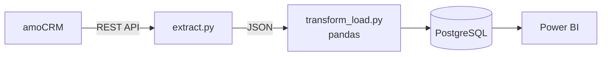

# amoCRM Sales Analytics — ETL Pipeline & Power BI Dashboard


Sales data is pulled from **amoCRM** via REST API with Python, cleaned with pandas, loaded into **PostgreSQL** as a star schema, and visualized in an interactive **Power BI** dashboard.


## Architecture



| Script | Purpose |
|---|---|
| `amo_test.py` | Checks the API connection |
| `create_test_data.py` · `setup_managers.py` | Seed 500 test deals and 4 managers via the API |
| `extract.py` | Pulls leads, contacts, stages and users (with pagination) |
| `transform_load.py` | Cleans the data and loads a star schema into PostgreSQL |

## Key insights

| Revenue | Deals won | Win rate | Avg deal | Open pipeline |
|---|---|---|---|---|
| 1 294.4M UZS | 132 / 501 | 45.5 % | 9.8M UZS | ≈ 2.0B UZS |

- **Biggest loss is the first step** — only 61 % of new leads reach needs analysis.
- **Manager win rates differ 2.7×** — from 76.1 % to 28.4 %, a clear coaching opportunity.
- **Referrals convert best (58.8 %)** but bring the fewest leads; the website converts worst (35.1 %).
- **July was the peak month** (379.7M UZS).

## Highlights

- Star schema with **two date relationships** — revenue is counted by closing date using `USERELATIONSHIP`
- **Cumulative funnel** measure in DAX (501 → 307 → 258 → 208 → 162 → 132)
- Custom dark theme, designed background, cross-filtering slicers and conditional formatting
- Re-runnable pipeline: `extract.py → transform_load.py → Refresh`

## How to run

```bash
pip install -r requirements.txt
cp .env.example .env        # add your amoCRM token and PostgreSQL password
python extract.py
python transform_load.py
```

Then open `dashboard/amoCRM_Sales_Dashboard.pbix` and click **Refresh**.

> Data is synthetic, generated through the amoCRM API on a trial account.

## Author

**Azizbek Gulmonov** — Junior Data Analyst

[GitHub](https://github.com/Azizbek0828) · [Telegram](https://t.me/ago_101) · [gulmonovazizbek@gmail.com](mailto:gulmonovazizbek@gmail.com)
