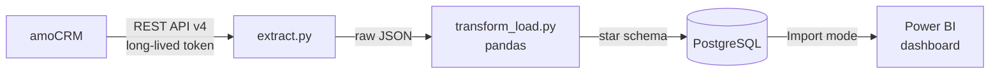
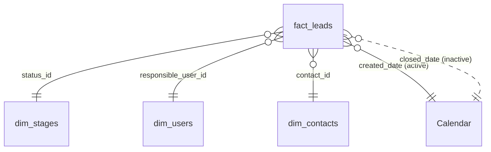

# amoCRM Sales Analytics — ETL Pipeline & Power BI Dashboard


End-to-end sales analytics project: sales data is pulled from **amoCRM** through its REST API with Python, cleaned and modeled with pandas, loaded into **PostgreSQL** as a star schema, and visualized in an interactive dark-themed **Power BI** dashboard.


---

## Table of contents

1. [Business questions](#business-questions)
2. [Architecture](#architecture)
3. [Project structure](#project-structure)
4. [ETL pipeline](#etl-pipeline)
5. [Data model](#data-model)
6. [DAX measures](#dax-measures)
7. [Dashboard](#dashboard)
8. [Key insights](#key-insights)
9. [Data validation (SQL)](#data-validation-sql)
10. [How to run](#how-to-run)
11. [Limitations & next steps](#limitations--next-steps)
12. [Author](#author)

---

## Business questions

The dashboard is built for a **head of sales** and answers four questions:

| # | Question | Visual |
|---|---|---|
| 1 | How are we doing overall? | 5 KPI cards |
| 2 | Where do we lose customers? | Cumulative sales funnel |
| 3 | Is revenue growing? | Monthly revenue + win rate combo chart |
| 4 | Which channels and managers perform best? | Source ranking + manager leaderboard |

## Architecture



## Project structure

```
amocrm-sales-analytics/
├── dashboard/
│   ├── amoCRM_Sales_Dashboard.pbix   # Power BI report
│   └── images/
│       └── dashboard.png             # dashboard screenshot
├── amo_test.py                       # 1. API connection check
├── create_test_data.py               # 2. seed 500 test deals + contacts
├── setup_managers.py                 # 3. create 4 managers, assign deals
├── extract.py                        # 4. Extract: amoCRM -> data/raw/*.json
├── transform_load.py                 # 5. Transform + Load: JSON -> PostgreSQL
├── requirements.txt
├── .env.example                      # template for credentials
└── .gitignore                        # keeps .env and data/ out of git
```

## ETL pipeline

| Step | Script | What it does |
|---|---|---|
| Connect | `amo_test.py` | Verifies the API token and lists pipeline stages with their IDs |
| Seed | `create_test_data.py` | Creates 500 realistic deals with contacts, amounts, products, sources and dates (last 6 months) via `POST /api/v4/leads/complex`, in batches of 50 |
| Seed | `setup_managers.py` | Creates 4 sales managers via `POST /api/v4/users` and assigns every deal and contact with intentionally different win rates |
| **Extract** | `extract.py` | Pulls leads (with linked contacts), contacts, pipelines and users. Handles **pagination** (250 rows per page) and saves raw JSON |
| **Transform** | `transform_load.py` | Converts Unix timestamps to `Asia/Tashkent` local time · extracts the main contact and lead source (tag) · derives `product` from the deal name · labels each deal `Won` / `Lost` / `Open` · calculates `days_to_close` · keeps only managers (admin account and e-mails are excluded) |
| **Load** | `transform_load.py` | Writes 4 tables to PostgreSQL with SQLAlchemy and adds primary keys. Full refresh — safe to re-run |

**Result of one run**

```
Bitimlar: 501 | Won: 132 | Lost: 158 | Open: 211
  dim_stages     ->    8 rows
  dim_users      ->    4 rows
  dim_contacts   ->  501 rows
  fact_leads     ->  501 rows
```

Updating the dashboard is just `extract.py → transform_load.py → Refresh` in Power BI.

## Data model

Star schema with one fact table and four dimensions:



`Calendar` has **two** relationships to `fact_leads`:
- **active** on `created_date` — when the lead arrived (used for lead counts and win rate)
- **inactive** on `closed_date` — when the money came in (used for revenue via `USERELATIONSHIP`)

### Data dictionary — `fact_leads`

| Column | Type | Description |
|---|---|---|
| `lead_id` | int (PK) | amoCRM deal ID |
| `lead_name` | text | Deal name, e.g. `Ноутбуки — Aziz Karimov` |
| `price` | int | Deal amount, UZS |
| `pipeline_id` | int | Sales pipeline |
| `status_id` | int (FK) | Current stage → `dim_stages` |
| `responsible_user_id` | int (FK) | Manager → `dim_users` |
| `contact_id` | int (FK) | Customer → `dim_contacts` |
| `source` | text | Lead channel: Telegram, Instagram, Звонок, Сайт, Рекомендация |
| `product` | text | Product category derived from the deal name |
| `outcome` | text | `Won` (status 142), `Lost` (status 143) or `Open` |
| `created_at` / `updated_at` / `closed_at` | timestamp | Local time (Asia/Tashkent) |
| `days_to_close` | int | Days from creation to closing (closed deals only) |
| `created_date` / `closed_date` | date | DAX calculated columns for calendar relationships |

## DAX measures

All measures are stored in a dedicated measures table.

| Measure | Format | Purpose |
|---|---|---|
| Total Leads | `#,0` | All deals |
| Won Deals | `#,0` | Deals with outcome `Won` |
| Lost Deals | `#,0` | Deals with outcome `Lost` |
| Win Rate % | `0.0%` | Won ÷ (Won + Lost) — closed deals only |
| Revenue | `#,0` | Sum of won deals by **closing** date |
| Avg Deal Size | `#,0` | Average won deal amount |
| Pipeline Value | `#,0` | Sum of open deals — potential revenue |
| Avg Days to Close | `0.0` | Average sales cycle of won deals |
| Funnel Leads | `#,0` | Cumulative funnel — deals that reached each stage |

```DAX
Total Leads = COUNTROWS(fact_leads)

Won Deals  = CALCULATE(COUNTROWS(fact_leads), fact_leads[outcome] = "Won")
Lost Deals = CALCULATE(COUNTROWS(fact_leads), fact_leads[outcome] = "Lost")

Win Rate % = DIVIDE([Won Deals], [Won Deals] + [Lost Deals])

Revenue =
CALCULATE(
    SUM(fact_leads[price]),
    fact_leads[outcome] = "Won",
    USERELATIONSHIP(fact_leads[closed_date], Calendar[Date])
)

Avg Deal Size =
CALCULATE(
    AVERAGE(fact_leads[price]),
    fact_leads[outcome] = "Won",
    USERELATIONSHIP(fact_leads[closed_date], Calendar[Date])
)

Pipeline Value = CALCULATE(SUM(fact_leads[price]), fact_leads[outcome] = "Open")

Avg Days to Close = CALCULATE(AVERAGE(fact_leads[days_to_close]), fact_leads[outcome] = "Won")

-- Cumulative funnel: a deal counts for every stage it has reached
Funnel Leads =
VAR CurOrder   = SELECTEDVALUE(dim_stages[stage_order])
VAR FirstOrder = CALCULATE(MIN(dim_stages[stage_order]), ALLSELECTED(dim_stages))
RETURN
IF(
    CurOrder = FirstOrder,
    CALCULATE([Total Leads], REMOVEFILTERS(dim_stages)),
    CALCULATE(
        [Total Leads],
        REMOVEFILTERS(dim_stages),
        dim_stages[stage_order] >= CurOrder,
        dim_stages[status_id] <> 143
    )
)
```

**Why a cumulative funnel?** Counting deals by their *current* stage does not produce a funnel — 132 won deals would show only in the last bar. A won deal has passed through every earlier stage, so `Funnel Leads` counts it at each one, giving a proper narrowing funnel: **501 → 307 → 258 → 208 → 162 → 132**.

## Dashboard

Single-page, 1280 × 720, custom dark theme and a designed background layout.

| Area | Visual | Details |
|---|---|---|
| Header | 3 slicers | Period (month), manager, lead source — every visual is cross-filtered |
| KPI row | 5 cards | Revenue · Deals won · Win rate · Avg deal size · Pipeline value |
| Top-left | Funnel | Cumulative funnel with stage-to-stage drop-off and overall conversion (26.3 %) |
| Top-right | Column + line | Monthly revenue (by closing date) vs. win rate |
| Bottom-left | Bar chart | Win rate by lead source, sorted, with lead count and revenue in tooltips |
| Bottom-right | Table | Manager leaderboard with data bars and traffic-light conditional formatting on win rate |

## Key insights

| Metric | Value |
|---|---|
| Revenue | **1 294.4M UZS** |
| Deals won | **132** of 501 leads |
| Win rate | **45.5 %** |
| Average deal size | **9.8M UZS** |
| Open pipeline | **≈ 2.0B UZS** |

1. **The biggest drop-off is the first step.** Only 307 of 501 new leads (61 %) reach needs analysis — faster first contact would have the largest impact.
2. **Manager performance differs 2.7×.** Win rate ranges from 76.1 % (Zarina Hamidova) to 28.4 % (Bobur Islomov) — a clear case for coaching and sharing best practices.
3. **Volume ≠ quality.** Jahongir Tursunov handled the most leads (141) but converted only 33.3 %, while Zarina closed 54 deals from 117 leads and generated the most revenue (528M).
4. **Referrals convert best (58.8 %)** but bring the fewest leads, so the rate is less reliable than for high-volume channels such as Telegram (47.1 %). The website converts worst (35.1 %).
5. **July was the peak month** (379.7M UZS). The current month is still in progress and should not be compared with complete months.

## Data validation (SQL)

Numbers in the dashboard were cross-checked against PostgreSQL:

```sql
-- Funnel: deals and amount per stage
SELECT s.stage_order, s.stage_name,
       COUNT(l.lead_id) AS deals,
       SUM(l.price)     AS amount
FROM dim_stages s
LEFT JOIN fact_leads l ON l.status_id = s.status_id
GROUP BY s.stage_order, s.stage_name
ORDER BY s.stage_order;

-- Manager leaderboard
SELECT u.user_name,
       COUNT(*) AS leads,
       SUM(CASE WHEN l.outcome = 'Won' THEN 1 ELSE 0 END) AS won,
       SUM(CASE WHEN l.outcome = 'Won' THEN l.price ELSE 0 END) AS revenue,
       ROUND(100.0 * SUM(CASE WHEN l.outcome = 'Won' THEN 1 ELSE 0 END)
             / NULLIF(SUM(CASE WHEN l.outcome <> 'Open' THEN 1 ELSE 0 END), 0), 1) AS win_rate_pct
FROM fact_leads l
JOIN dim_users u ON u.user_id = l.responsible_user_id
GROUP BY u.user_name
ORDER BY win_rate_pct DESC;
```

## How to run

**Requirements:** Python 3.10+, PostgreSQL, Power BI Desktop, an amoCRM account with a long-lived API token.

```bash
# 1. Install dependencies
pip install -r requirements.txt

# 2. Configure credentials
cp .env.example .env        # then fill in the amoCRM token and PostgreSQL password

# 3. Create the database (once)
#    pgAdmin -> Create -> Database -> amocrm_db

# 4. Run the pipeline
python amo_test.py          # check the connection
python extract.py           # amoCRM -> data/raw/*.json
python transform_load.py    # JSON  -> PostgreSQL
```

Open `dashboard/amoCRM_Sales_Dashboard.pbix` and click **Home → Refresh**.

> `create_test_data.py` and `setup_managers.py` are only needed for an empty demo account. Run each of them **once** — every run adds new deals.

## Limitations & next steps

- **Synthetic data.** Deals were generated through the amoCRM API on a trial account to simulate a real sales team.
- **Where deals are lost.** Lost deals are assumed to drop out after the first stage. Pulling stage history from the amoCRM **events API** would show the exact stage where each deal was lost.
- **Weighted pipeline.** Multiplying open deal amounts by stage probability would give a more realistic revenue forecast.
- **Data quality alert.** Deals left in *Оплата получена* without being moved to *Успешно реализовано* understate revenue — a monitoring report could flag them.
- **Automation.** Schedule the ETL (Windows Task Scheduler or Airflow) and publish to Power BI Service with scheduled refresh.

## Author

**Azizbek Gulmonov** — Junior Data Analyst

Python · SQL · PostgreSQL · Power BI · Excel

- GitHub: [@Azizbek0828](https://github.com/Azizbek0828)
- Telegram: [@ago_101](https://t.me/ago_101)
- E-mail: [gulmonovazizbek@gmail.com](mailto:gulmonovazizbek@gmail.com)

Open to Junior Data Analyst opportunities — feel free to reach out.
