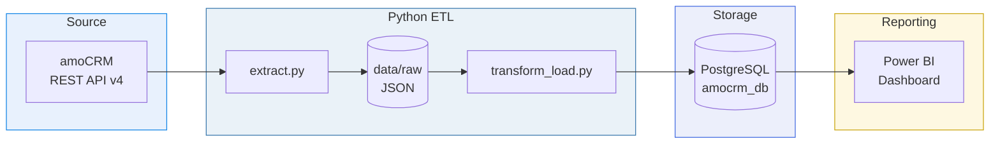
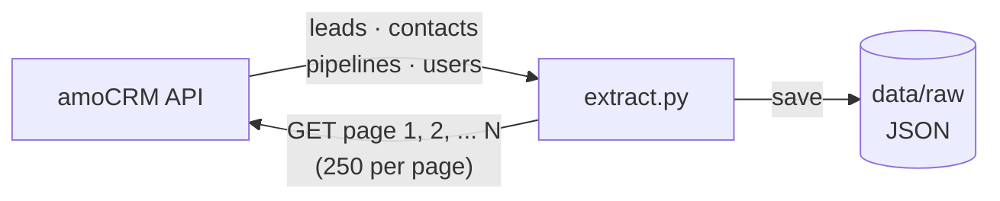
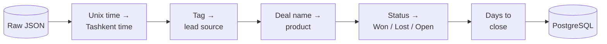
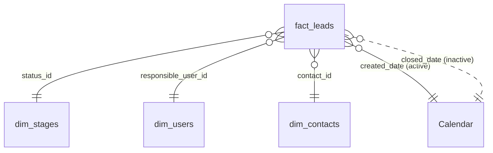

<div align="center">

# amoCRM Sales Analytics

**End-to-end data pipeline: amoCRM API → Python ETL → PostgreSQL → Power BI**


</div>

---

## Contents

1. [About the project](#1-about-the-project)
2. [Architecture](#2-architecture)
3. [Extract — getting data from amoCRM](#3-extract--getting-data-from-amocrm)
4. [Transform & Load](#4-transform--load)
5. [Data model](#5-data-model)
6. [Dashboard](#6-dashboard)
7. [Project structure](#7-project-structure)
8. [How to run](#8-how-to-run)

---

## 1. About the project

A sales team keeps all its deals in **amoCRM**, but the CRM's built-in reports don't answer the key management questions in one place.
This project automatically pulls the data out of amoCRM, cleans it, stores it in a database, and turns it into an interactive Power BI dashboard.

**Questions the dashboard answers**

- How much revenue did we make, and how is it changing month by month?
- At which funnel stage do we lose the most deals?
- Which lead sources bring customers who actually buy?
- Which manager performs best?

---

## 2. Architecture



| Step | Script / Tool | Output |
|---|---|---|
| Extract | `extract.py` | Raw JSON files |
| Transform | `transform_load.py` (pandas) | Clean tables |
| Load | `transform_load.py` (SQLAlchemy) | PostgreSQL tables |
| Visualize | Power BI + DAX | Dashboard |

---

## 3. Extract — getting data from amoCRM

`extract.py` connects to the amoCRM REST API with a long-lived token and reads every record page by page.



| Endpoint | Data |
|---|---|
| `/api/v4/leads?with=contacts` | Deals with their linked contacts |
| `/api/v4/contacts` | Customers |
| `/api/v4/leads/pipelines` | Funnel stages |
| `/api/v4/users` | Managers |

---

## 4. Transform & Load

`transform_load.py` cleans the raw JSON with pandas and loads it into PostgreSQL.



**Load rules**

- Full refresh on every run (`if_exists="replace"`), so the script is safe to run again and again
- Primary keys are added after loading
- Only managers who own deals are loaded; the account administrator and personal emails are excluded

---

## 5. Data model

The tables form a **star schema**: one fact table in the center, with dimension tables around it.



| Table | Type | Description |
|---|---|---|
| `fact_leads` | Fact | One row per deal |
| `dim_stages` | Dimension | Funnel stages and their order |
| `dim_users` | Dimension | Sales managers |
| `dim_contacts` | Dimension | Customers |
| `Calendar` | Dimension (DAX) | Date table |

> `Calendar` has two relationships with `fact_leads`. The **active** one is on `created_date`. The **inactive** one is on `closed_date` and is switched on with `USERELATIONSHIP` to show revenue by closing date.

---

## 6. Dashboard

The dashboard is built on a single page so the whole sales picture is visible at once.

| Block | What it shows |
|---|---|
| Filters | Period, manager, lead source |
| KPI cards | Revenue, deals won, conversion, average deal, open pipeline |
| Sales funnel | Deals reaching each stage (cumulative DAX measure) |
| Monthly trend | Revenue and conversion over time |
| Lead sources | Conversion by channel |
| Managers | Performance table with conditional formatting |

**Design:** custom dark theme (JSON), a background layout designed in Python, and cross-filtering between all visuals.

---

## 7. Project structure

```
amocrm-sales-analytics/
│
├── extract.py               # amoCRM API → data/raw/*.json
├── transform_load.py        # JSON → pandas → PostgreSQL
├── create_test_data.py      # generates test deals in amoCRM
├── setup_managers.py        # creates managers and assigns deals
│
├── dashboard/
│   ├── amoCRM_Sales_Dashboard.pbix
│   └── images/
│       └── dashboard.png
│
├── requirements.txt
├── .env.example             # template for credentials
└── .gitignore               # .env and data/ are not published
```

---

## 8. How to run

```bash
# 1. Install dependencies
pip install -r requirements.txt

# 2. Add your credentials
cp .env.example .env         # amoCRM token + PostgreSQL connection

# 3. Run the pipeline
python extract.py
python transform_load.py
```

Then open `dashboard/amoCRM_Sales_Dashboard.pbix` and click **Refresh**.

> **Note:** all data is synthetic. It was generated through the amoCRM API on a trial account.

---

<div align="center">

**Azizbek Gulmonov** · Junior Data Analyst

[](https://github.com/Azizbek0828)
[](https://t.me/ago_101)
[](mailto:gulmonovazizbek@gmail.com)

</div>
