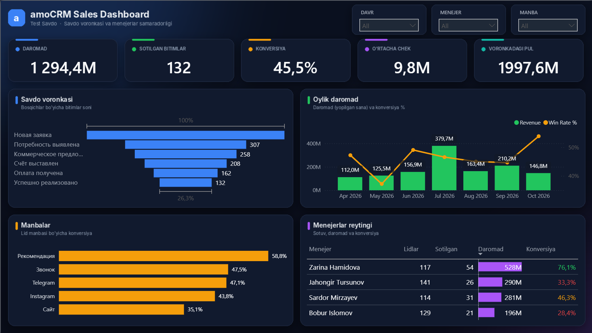
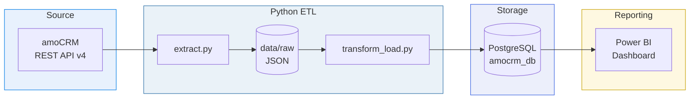
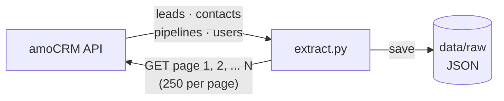
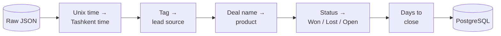
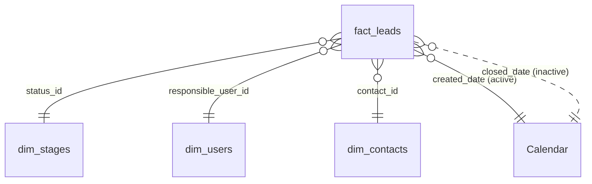

<div align="center">

# amoCRM Sales Analytics

**Scheduled pipeline: amoCRM API → Airflow in Docker → Python ETL → PostgreSQL → Power BI**




</div>

---

## Contents

1. [About the project](#1-about-the-project)
2. [Architecture](#2-architecture)
3. [Extract — getting data from amoCRM](#3-extract--getting-data-from-amocrm)
4. [Transform & Load](#4-transform--load)
5. [Data model](#5-data-model)
6. [Dashboard](#6-dashboard)
7. [Project structure](#7-project-structure)
8. [How to run](#8-how-to-run)

---

## 1. About the project

A sales team keeps all its deals in **amoCRM**, but the CRM's built-in reports don't answer the key management questions in one place.
This project automatically pulls the data out of amoCRM, cleans it, stores it in a database, and turns it into an interactive Power BI dashboard.

**Questions the dashboard answers**

- How much revenue did we make, and how is it changing month by month?
- At which funnel stage do we lose the most deals?
- Which lead sources bring customers who actually buy?
- Which manager performs best?

---

## 2. Architecture



| Step | Script / Tool | Output |
|---|---|---|
| Extract | `pipelines/extract.py` | Raw JSON files |
| Transform | `pipelines/transform_load.py` (pandas) | Clean tables |
| Load | `pipelines/transform_load.py` (SQLAlchemy) | PostgreSQL tables |
| Visualize | Power BI + DAX | Dashboard |

---

## 3. Extract — getting data from amoCRM

`pipelines/extract.py` connects to the amoCRM REST API with a long-lived token and reads every record page by page.



| Endpoint | Data |
|---|---|
| `/api/v4/leads?with=contacts` | Deals with their linked contacts |
| `/api/v4/contacts` | Customers |
| `/api/v4/leads/pipelines` | Funnel stages |
| `/api/v4/users` | Managers |

---

## 4. Transform & Load

`pipelines/transform_load.py` cleans the raw JSON with pandas and loads it into PostgreSQL.



**Load rules**

- Full refresh on every run (`if_exists="replace"`); all tables and primary keys are updated in one PostgreSQL transaction. A failed load rolls back the refresh
- Primary keys are added after loading
- Only managers who own deals are loaded; the account administrator and personal emails are excluded

---

## 5. Data model

The tables form a **star schema**: one fact table in the center, with dimension tables around it.



| Table | Type | Description |
|---|---|---|
| `fact_leads` | Fact | One row per deal |
| `dim_stages` | Dimension | Funnel stages and their order |
| `dim_users` | Dimension | Sales managers |
| `dim_contacts` | Dimension | Customers |
| `Calendar` | Dimension (DAX) | Date table |

> `Calendar` has two relationships with `fact_leads`. The **active** one is on `created_date`. The **inactive** one is on `closed_date` and is switched on with `USERELATIONSHIP` to show revenue by closing date.

---

## 6. Dashboard

The dashboard is built on a single page so the whole sales picture is visible at once.

| Block | What it shows |
|---|---|
| Filters | Period, manager, lead source |
| KPI cards | Revenue, deals won, conversion, average deal, open pipeline |
| Sales funnel | Deals reaching each stage (cumulative DAX measure) |
| Monthly trend | Revenue and conversion over time |
| Lead sources | Conversion by channel |
| Managers | Performance table with conditional formatting |

**Design:** custom dark theme (JSON), a background layout designed in Python, and cross-filtering between all visuals.

Two independent Power BI files are provided:

| File | Purpose |
|---|---|
| [amoCRM_Sales_Dashboard.pbix](dashboard/amoCRM_Sales_Dashboard.pbix) | Example report with the saved synthetic sales data |
| [amoCRM_Sales_Template.pbit](dashboard/amoCRM_Sales_Template.pbit) | Reusable report template for connecting to your own PostgreSQL database |

The template contains the visuals, queries, relationships and DAX definitions,
but no imported table rows. It prompts for `DB_Server` and `DB_Name` when opened.
The original `.pbix` is not required to use the template. Changes to a `.pbix`
do not automatically update an exported `.pbit`; export the template again after editing.
GitHub hosts the downloadable files and preview image. Open the report or
template in Power BI Desktop to use its interactive visuals.

---

## 7. Project structure

```text
amocrm-sales-analytics/
├── airflow/
│   ├── docker-compose.yaml      # Airflow, Redis, Airflow metadata DB
│   ├── Dockerfile               # Airflow 3.3.2 + ETL requirements
│   ├── .env.example             # Docker settings, no real secrets
│   ├── dags/amocrm_etl_dag.py    # Schedule and task dependencies
│   ├── logs/                    # Generated, ignored by Git
│   └── config/                  # Generated, ignored by Git
├── pipelines/
│   ├── __init__.py
│   ├── extract.py               # amoCRM API → raw JSON
│   ├── transform_load.py        # Raw JSON → four PostgreSQL tables
│   └── verify_load.py           # Compare loaded and expected row counts
├── scripts/
│   ├── prepare_env.py           # Create local env files, preserve existing ones
│   ├── amo_test.py              # Manual API connection check
│   ├── create_test_data.py      # Manual creation of data in CRM
│   └── setup_managers.py        # Manual CRM users/deal assignment
├── data/raw/                   # Generated, one folder per DAG run; ignored
├── dashboard/
│   ├── amoCRM_Sales_Dashboard.pbix # Example report
│   ├── amoCRM_Sales_Template.pbit # Template with connection parameters
│   └── images/dashboard.png      # Preview image
├── requirements.txt
├── .env.example                # API settings + standalone Windows DB settings
├── .dockerignore
└── .gitignore
```

The helper scripts that create or change CRM records are never run by the DAG.
Airflow imports only the DAG definition; API requests happen inside the extract task.

## 8. How to run

### Prerequisites

- Docker Desktop running Linux containers and Docker Compose.
- Python 3.10+ on the host for the one-time environment preparation script.
- At least 4 GB available to Docker; 8 GB is recommended.
- Docker can download images and Python packages on the first build.
- PostgreSQL installed and running on Windows, with a database and user prepared in pgAdmin.
- Power BI Desktop to open the report or template.

The Compose setup follows the Smartup project: **Airflow runs in Docker and
sales data is loaded into your existing Windows PostgreSQL database**.
The `postgres` service in Compose stores only Airflow metadata (runs, tasks, users).
Six long-running services are used: API server, scheduler, DAG processor,
worker, Redis, and Airflow's PostgreSQL. `airflow-init` runs once and exits.
This DAG uses BashOperator tasks and does not need a triggerer, Flower or a
separate CLI service. For CLI diagnostics, use `docker compose exec airflow-worker airflow ...`.

Create the sales database in pgAdmin if it does not exist, then set the root `.env`:

```dotenv
PG_HOST=localhost
PG_PORT=5432
PG_DB=amocrm_db
PG_USER=postgres
PG_PASSWORD=your_windows_postgresql_password
```

Use your actual database, username, port and password. Inside Docker, Compose
overrides only `PG_HOST` with `host.docker.internal`, which points to Windows.
The other four values come directly from the root `.env`. A teacher uses their
own Windows PostgreSQL credentials; there are no fixed paths or shared passwords.
PostgreSQL must accept connections arriving from Docker Desktop. If connection
fails, inspect the error before changing PostgreSQL or firewall settings.

### First start (PowerShell, from the repository root)

```powershell
python scripts/prepare_env.py
cd airflow
docker compose config --quiet
docker compose build
docker compose up airflow-init
docker compose up -d
docker compose ps
```

The preparation script creates `.env` and `airflow/.env` if needed, generates
Airflow encryption/signing keys, and preserves existing credentials. Fill in the
Windows PostgreSQL credentials in the root `.env` before running the DAG.
It never prints the secrets. Both env files are ignored by Git.
On Linux, set `AIRFLOW_UID` in `airflow/.env` to your host user's UID before starting.

Open **http://localhost:8081**, sign in with the local quick-start account
`airflow` / `airflow`. Wait until services are healthy. The DAG is named
**amocrm_sales_etl**. It starts paused so no API extraction happens just by
starting the containers. Unpause it when ready, then use **Trigger DAG** for a manual run.

### amoCRM connection

Fill in the **root `.env`** with your working amoCRM credentials:

```dotenv
AMO_SUBDOMAIN=your_subdomain
AMO_TOKEN=your_long_lived_token
```

The ETL always reads from the amoCRM API. A teacher needs their own valid
amoCRM credentials and Windows PostgreSQL credentials in the root `.env`.
Neither `.env` file is published. After changing either file, recreate the
services from the `airflow` directory:

```powershell
docker compose up -d
```

The DAG runs **every day at 08:00 Asia/Tashkent** after it is unpaused, while
Docker and the computer are running. `catchup=False` prevents a backlog of old
scheduled runs. `max_active_runs=1` prevents overlapping refreshes. Each task
has two retries, a two-minute retry delay, and a 30-minute execution timeout.
API calls also have request timeouts and limited retries for transient errors.

```text
extract → transform_load → verify_load
```

The last task checks every table's row count against the current run's JSON.
Only successful upstream tasks allow the next task to start. Each run writes
under `data/raw/<run_id>/`; remove obsolete run folders manually when no longer needed.

### Check SQL results (teacher/reviewer)

In **pgAdmin**, use your existing Windows server connection. Open
`Databases → amocrm_db` (or your `PG_DB`), then **Query Tool**.
Do not query the Airflow metadata database in Docker.

Run these queries:

```sql
SELECT 'fact_leads' AS table_name, COUNT(*) FROM fact_leads
UNION ALL SELECT 'dim_contacts', COUNT(*) FROM dim_contacts
UNION ALL SELECT 'dim_users', COUNT(*) FROM dim_users
UNION ALL SELECT 'dim_stages', COUNT(*) FROM dim_stages;

SELECT outcome, COUNT(*) AS deals, SUM(price) AS total_price
FROM fact_leads GROUP BY outcome ORDER BY outcome;
```

To review task failures, run this from the `airflow` directory:

```powershell
docker compose logs --tail 100 airflow-worker
```

You can also use each task's Logs tab in Airflow.

### Use the dashboard with your own data

1. Configure your amoCRM and Windows PostgreSQL credentials in the root `.env`.
2. Run the `amocrm_sales_etl` DAG and wait for `extract`, `transform_load` and
   `verify_load` to succeed. Check the tables in pgAdmin as described above.
3. Download or open [dashboard/amoCRM_Sales_Template.pbit](dashboard/amoCRM_Sales_Template.pbit)
   in Power BI Desktop.
4. Fill in the connection parameters and select **Load**:

   | Parameter | Value to enter | Local example |
   |---|---|---|
   | `DB_Server` | PostgreSQL host, optionally followed by `:port` | `localhost` or `localhost:5432` |
   | `DB_Name` | Your PostgreSQL database name; match `PG_DB` in `.env` | `amocrm_db` |

5. If prompted, select **Database** authentication and enter your own
   PostgreSQL username and password, matching `PG_USER` and `PG_PASSWORD`.
   Passwords are entered in the connection dialog, not in the template parameters.
6. Wait for the data to load and confirm the visuals show your sales data.
   Use **File → Save as** to save the resulting report as your own `.pbix`.

For Power BI Desktop running on Windows, use the actual PostgreSQL address
(usually `localhost`). `host.docker.internal` is used by the Airflow containers
to reach Windows; it is not the default server value for Power BI Desktop.

The template requires the `public.fact_leads`, `public.dim_contacts`,
`public.dim_users` and `public.dim_stages` tables with the columns and data
types produced by this project's ETL. It is not a template for arbitrary
Excel files or unrelated database schemas. The database must be populated
before loading the template. `Calendar` and the measures are defined in Power BI.

The existing example `.pbix` can also be reused: open it and update the source
in **File → Options and settings → Data source settings**, then enter your own
database credentials and select **Refresh**. The `.pbit` provides connection
parameters so you do not need to edit four queries individually.

If Power BI cannot authenticate, re-enter the Windows PostgreSQL credentials.
If it reports an encrypted-connection error for your local `localhost` database,
check **Data source settings → Edit Permissions → Encrypt connections**.
For a local development server without SSL, clear this checkbox and retry.
For a remote server, use the server's SSL configuration and valid certificate.

After subsequent successful DAG runs, select **Refresh** in Power BI Desktop
to reload the report. Airflow automates extraction and database loading;
Power BI Desktop visuals do not refresh just because the database changed.
Power BI Service scheduled refresh is not configured by this project.

References: [Power BI report templates](https://learn.microsoft.com/en-us/power-bi/create-reports/desktop-templates)
and [PostgreSQL connector](https://learn.microsoft.com/en-us/power-query/connectors/postgresql).

### Stop and restart

```powershell
docker compose stop
docker compose up -d
```

The named volume keeps Airflow metadata across container recreation.
Sales data stays in Windows PostgreSQL. `docker compose stop` stops Airflow
services; it does not stop the Windows PostgreSQL service.

### GitHub publishing

Publish the code, Dockerfile, Compose, `.env.example` files, example `.pbix`,
and reusable `.pbit` template.
Do not publish `.env`, `airflow/.env`, generated `airflow.cfg`, logs, raw CRM
exports, or Python environments. Check before committing:

```powershell
git status --short
git ls-files .env airflow/.env
```

The second command must have no output. Git ignore rules do not remove files
already tracked by Git; remove such files from the Git index before publishing.
There are no absolute Windows paths in the shared configuration.

---

<div align="center">

**Azizbek Gulmonov** · Junior Data Analyst

[](https://github.com/Azizbek0828)
[](https://t.me/ago_101)
[](mailto:gulmonovazizbek@gmail.com)

</div>
